# IceeBoot Frontend

[简体中文](README.md) | **English**

IceeBoot is a Vue 3 and TypeScript admin console for AI applications. Users sign in from the home page, submit requests, and review approvals. Administrators manage roles, configure agents and model connections, and connect infrastructure services. The interface supports Chinese and English, with light and dark themes.

| What would you like to do? | Start here |
| --- | --- |
| Sign in and explore the console on your machine | [Run the local demo](#mock-start) |
| Work with your own users, data, and permissions | [Connect to the Java backend](#live-start) |
| Give a role access to a new business page | [Add a menu and API permissions with an AI coding assistant](#ai-menu) |
| Let an agent run a script in a sandbox | [Configure a model and sandbox, then publish the agent](#sandbox-start) |

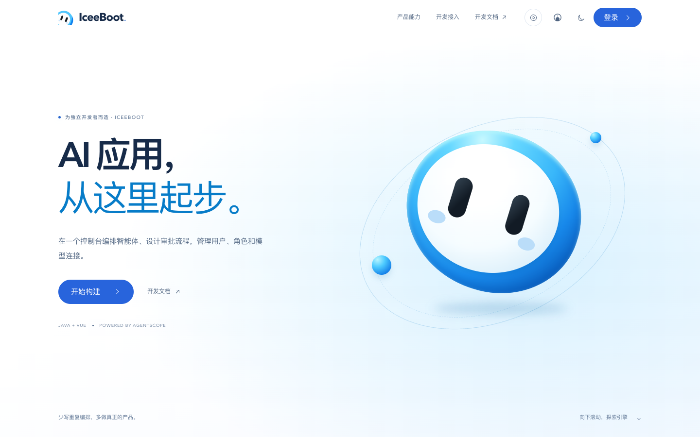

[Watch the home page scroll animation](docs/screenshots/home-scroll.webp)

<a id="mock-start"></a>

## Run the local demo

Use Node.js 20.x starting at 20.19.0, or Node.js 22.12.0 or later. Run these commands from the frontend repository root.

```bash
npm ci
npm run dev:mock
```

Open the [local home page](http://localhost:4396), click **Sign in (登录)** in the upper right, and use the demo username `admin` and password `111111`. Mock mode uses sample data in the browser, so you can explore the forms and test UI interactions. Connect to the Java backend to use WeChat authorization, make real model requests, or process payments.

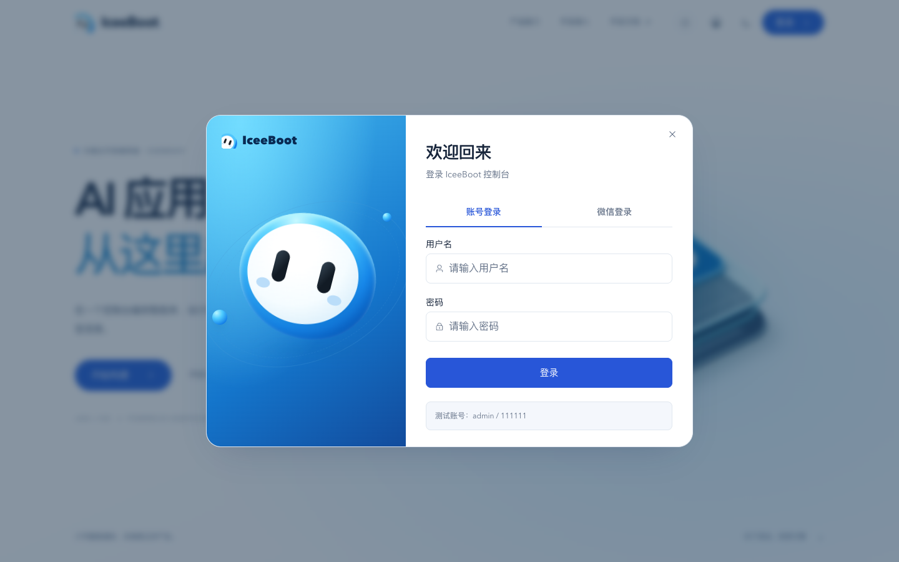

<a id="live-start"></a>

### Connect to the Java backend

1. Set up JDK 21, MySQL, and Redis for the backend. Configure `DB_URL`, `DB_USERNAME`, `DB_PASSWORD`, and the Redis connection in the backend process environment. Use a dedicated empty database for the initial SQL import. See the [backend database setup](https://github.com/perfectNB/IceeBoot-backend-java/blob/master/README.en.md#database-setup) for the commands and configuration.
2. Start the backend and open the [local API documentation](http://localhost:9000/iceeboot/api/swagger-ui/index.html) to check the service address. Stop the mock development server if it is using port 4396.
3. Run `npm run dev` in the frontend repository and sign in using an account from your backend. The default base URL for local development is `http://localhost:9000/iceeboot`. To use a different backend, create `.env.local` in the frontend repository root, set the base URL, and restart Vite.

```dotenv
VITE_APP_BASE_API=http://localhost:9000/iceeboot
VITE_USE_MOCK=false
```

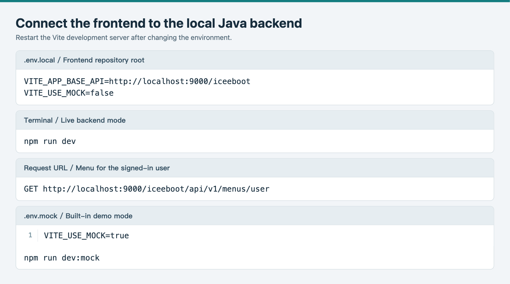

To check the connection after signing in, look for `menus/user` in the browser's **Network** panel. With the local configuration above, the full URL is `http://localhost:9000/iceeboot/api/v1/menus/user`. The response should contain the menu entries visible to the signed-in user. If the request path contains `/api/api/v1`, change the end of the base URL to `/iceeboot`. For a CORS error, check that the backend allows the frontend's origin. Keep database passwords, model API keys, and cloud credentials on the backend. Values in `VITE_` variables can appear in the browser.

## Explore the console

| Area | What you can do |
| --- | --- |
| Dashboard (工作台) | View user counts, login activity, account status, and recent actions. |
| System management and monitoring | Manage users, roles, menus, and API permissions. Inspect logs, caches, and jobs. The current role determines which menus and actions are available. |
| Agent console (智能体控制台) | Configure models, prompts, skills, tools, MCP services, knowledge base connections, and sandbox templates. Publish an agent to chat with it and inspect runs, usage, and output files. |
| Workflow management | Design approval routes, amount-based conditions, countersignatures, and eligible applicant roles. Manage drafts and versions in **Process definitions (流程定义)**. Choose a template in **Start approval (发起审批)** and track work in **My applications (我的申请)** and **My approvals (我的审批)**. |
| Third-party services and payments | Configure file storage, SMS, email, and payment channels. Review the resulting records. Delivery, uploads, and payments require working backend provider settings. |
| Code generation | Select database tables, set generation options, and preview frontend and backend code. |

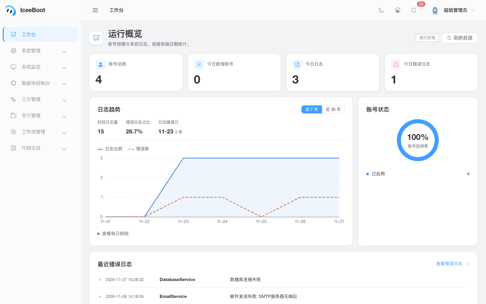

<a id="ai-menu"></a>

## Add a menu and API permissions with an AI coding assistant

When connected to the backend, the frontend receives the signed-in user's menus and loads the corresponding Vue components from [src/pages](src/pages). This example adds a read-only **Inspection records** page under **System management**. Open both repositories in the same workspace. In the prompt below, replace `<inspection-role-code>` with the code of the role you created for inspectors in **Role management (角色管理)**. Then give the prompt to your coding assistant.

```text
Read AGENTS.md in both repositories. Follow the existing System management
pages and backend dynamic permission mappings. Add a read-only Inspection
records page for <inspection-role-code>. Before implementing it, list
the files, menu entries, and permission mappings you plan to change.

1. Put the page under System management (系统管理). Use InspectionRecords
   as the route name and component name, /admin/system/inspection-records
   as the route path, and src/pages/admin/system/InspectionRecords.vue
   as the page file.
2. Look for an existing inspection list endpoint. If it is missing, add
   one using the project's pagination conventions. Use system:inspection:view
   for page access and system:inspection:list:api for GET /v1/inspections.
   Wrap GET /api/v1/inspections in src/api. On the backend, use
   @RequirePermission(dynamic = true).
3. Add and register a versioned migration that is safe to rerun. Register
   the menu, permissions, and role associations. Resolve records by parent
   menu, route name, and permission code. Preserve existing grants and grant
   the new read-only capabilities only to the specified role. Update the API
   permission catalog and the relevant tests.
4. Update the frontend mock menus, role permissions, and list data so
   dev:mock also works. Verify the result against a local development
   database with both an authorized and an unauthorized account. Report
   what each account could see and whether the API allowed the request.
```

After applying the code and migration, sign in to the development environment and check the result in these three places. The screenshots use the existing **User management (用户管理)** page and its list endpoint as examples.

1. **System management → Menu management (系统管理 → 菜单管理).** Check the parent menu, title, route name, path, and component. For the new page, use `InspectionRecords` to match `src/pages/admin/system/InspectionRecords.vue`. Match the capitalization and omit the `.vue` extension.

   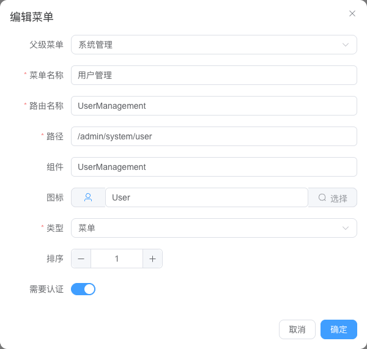

2. **System management → Permission management (系统管理 → 权限管理).** Find the list permission, set its type to **API (接口)**, and check the permission code, HTTP method, and controller path. The screenshot shows `GET /v1/users` with `system:user:list:api`. For inspections, use `GET /v1/inspections` and `system:inspection:list:api`.

   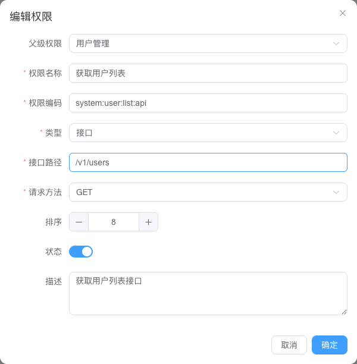

3. **System management → Role management (系统管理 → 角色管理).** In the target role's row, click **Menus (菜单)**, select the parent menu and page, and click **Save menus (保存菜单)**.

   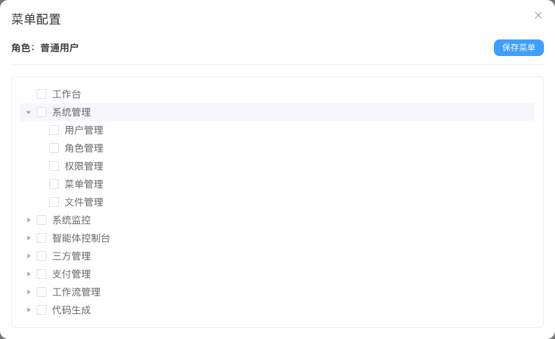

   In the same role's row, click **Permissions (权限)**, select the page-view and list permissions, and click **Save permissions (保存权限)**. Sign in again with an inspector account and check that the page opens and shows records. Verify that an unauthorized account receives an access denial when calling the same endpoint directly. Include ordinary roles in this test because a super administrator has all permissions.

   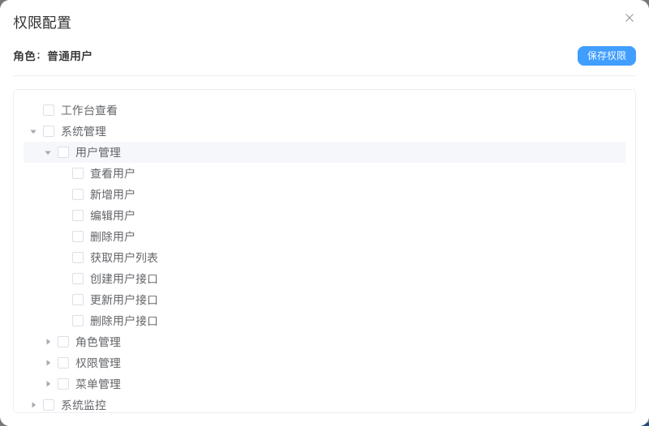

| Symptom | What to check |
| --- | --- |
| The menu is missing from the sidebar | Inspect the response to `GET /api/v1/menus/user`. Check the role's grants for both the parent menu and the page. |
| The menu opens a blank page | Look for “未找到菜单组件” (menu component not found) in the browser console. Check the component name, capitalization, and file location. |
| The page opens but the query is denied | Check the role's list API permission, HTTP method, and path pattern. |

See the [backend menu configuration guide](https://github.com/perfectNB/IceeBoot-backend-java/blob/master/README.en.md#ai-menu) for the migration and verification steps.

<a id="sandbox-start"></a>

## Configure a model and sandbox, then publish the agent

The screenshots below show the mock console. Use them to find the controls, then connect the frontend to the Java backend to run a real Python script.

1. **Connect a model and the cloud provider.** Open **Agent console → Model connections (智能体控制台 → 模型连接)** and create a connection. Select the provider and API protocol, enter the model identifier and API key, enable the connection, and save. In live mode, **Test (测试)** sends a model request.

   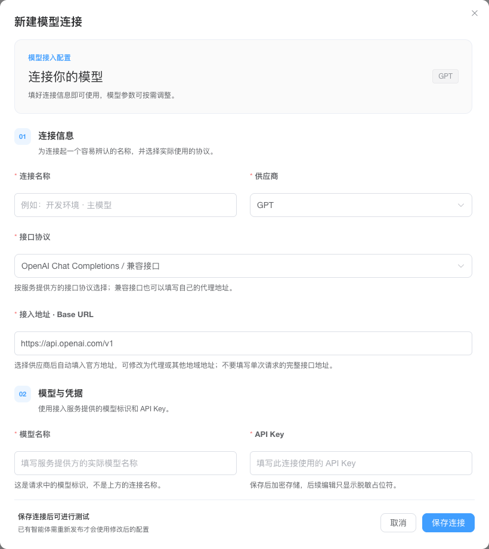

   Set `ALIYUN_E2B_API_BASE_URL`, `ALIYUN_E2B_DOMAIN`, and `ALIYUN_E2B_API_KEY` in the backend process environment. Prepare a template in your cloud account that includes Python and the dependencies your script needs. See the [backend E2B setup](https://github.com/perfectNB/IceeBoot-backend-java/blob/master/README.en.md#e2b-setup).

2. **Register the sandbox template.** Open **Agent console → Sandbox templates (智能体控制台 → 沙箱模板)**. Check the list for a suitable template or click **New sandbox template (新建沙箱模板)**.

   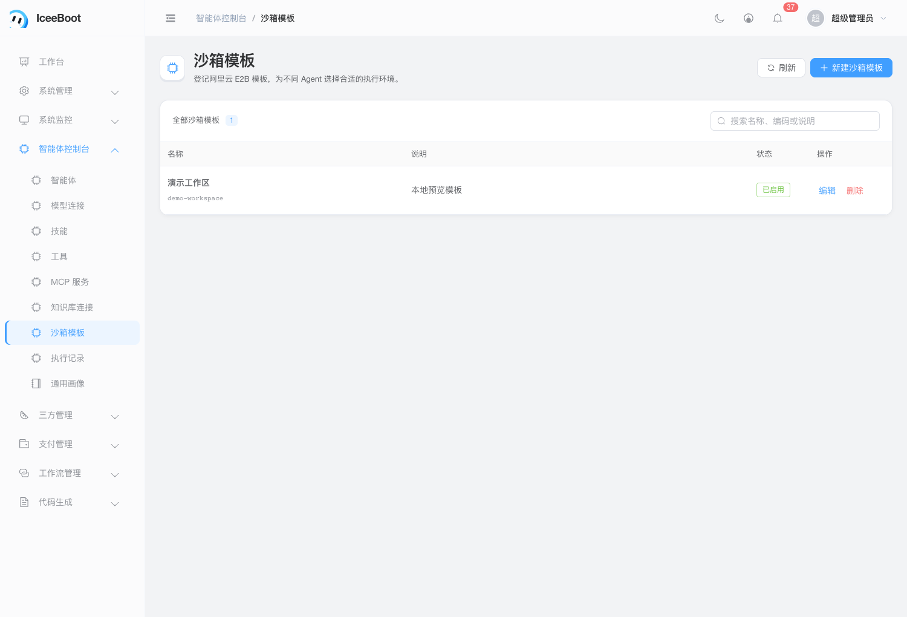

   For **Name (名称)** you could enter `Python reports`. For **Unique code (唯一编码)** you could use `python_reports`. IceeBoot uses this code internally and fixes it at creation. In **Alibaba Cloud E2B template ID / name (阿里云 E2B 模板 ID / 名称)**, enter the identifier of the template you published in the cloud. Set the sandbox lifetime in seconds (default 600, range 60–3600), enable the template, and save it.

   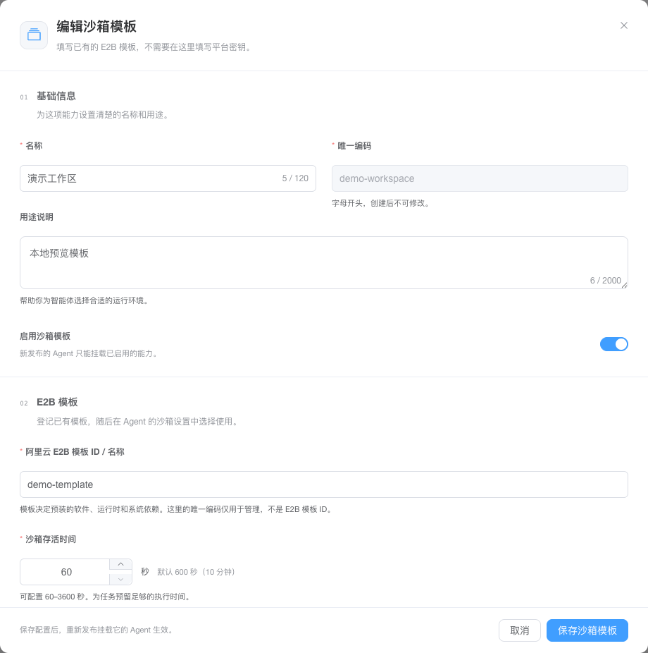

3. **Assign the template to the agent.** Open **Agent console → Agents (智能体控制台 → 智能体)** and create or edit an agent. Under **Basic information (基础信息)**, set the name, unique code, and model. Describe the task under **Prompt (提示词)**. Return to the execution settings in Basic information, enable **E2B sandbox (E2B 沙箱)**, and select the template you just registered. If the task needs credentials, set the variables it uses under **Environment variables (环境变量)** for this agent.

   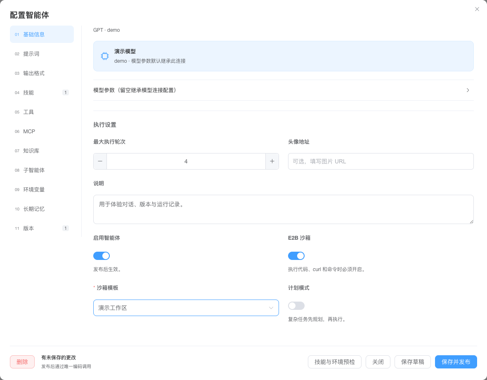

4. **Check the environment and run the agent.** To run an existing script, configure and attach the relevant **Skill (技能)** or **Tool (工具)**. Click **Save draft (保存草稿)**. From the agent list, reopen **Configure → Skill and environment preflight (配置 → 技能与环境预检)** and click **Start preflight (开始预检)** to check the saved draft. With a live backend and sandbox enabled, preflight creates a temporary sandbox and releases it after the check.

   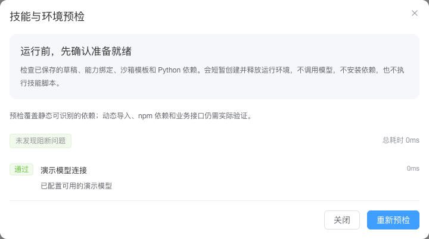

   Once preflight passes, click **Save and publish (保存并发布)**. From the agent list, click **Start conversation (开始对话)** and send a task that requires the script. Check the tool calls and output under **Execution history (执行记录)**. If the template selector is empty, check that the template is enabled. If a script reports a missing dependency, check the runtime and packages installed in the cloud template.

## Frontend architecture

Pages call domain-specific methods from `src/api`. In live mode, the shared HTTP layer attaches credentials, refreshes tokens, and handles API errors. Modules with mock support use local services in demo mode, so both modes share the same forms, queries, and pagination.

```text
Home / Sign-in / Admin pages
        │
        ├── Vue Router + Pinia     Route guards, session, menus, and action permissions
        └── src/api               API methods and types organized by domain
              ├── src/utils/request.ts → Java REST API / SSE
              └── src/mock             → Demo services and sample data
```

| Path | What you will find |
| --- | --- |
| [src/pages](src/pages) · [src/layouts](src/layouts) | Home, admin layouts, and business pages. Approval pages live in `src/pages/admin/workflow`. |
| [src/components](src/components) · [src/styles](src/styles) | Shared forms, the sign-in dialog, brand animations, and themes. Animations respect the system's reduced-motion preference. |
| [src/router](src/router) · [src/stores](src/stores) | Page registration, navigation guards, the signed-in user, and menu state. The backend enforces authorization for each action. |
| [src/api](src/api) · [src/types](src/types) | Backend paths, request parameters, response types, and pagination contracts. |
| [src/mock](src/mock) · [tests](tests) | Demo data, behavior corresponding to live endpoints, and regression tests for permissions, pagination, and state changes. |
| [src/locales](src/locales) | Chinese and English labels, form hints, buttons, and status messages. |

## Verify and deploy

| Command | Result |
| --- | --- |
| `npm run type-check` | Type-check TypeScript and Vue templates. |
| `sh scripts/verify.sh` | Run API and mock tests, ESLint, type checking, and the production build. |
| `npm run build` / `npm run build:mock` | Build static files for the live backend or the standalone demo in `dist/`. |
| `npm run preview` | Serve the most recent build locally. |

Set `VITE_APP_BASE_API` in the build environment before building for production. Serve `dist/` as the site root. Vue Router uses history mode, so configure the web server to return `index.html` when a user directly opens or refreshes an `/admin/…` page. If the API uses the same domain, match the API reverse proxy route before applying the page fallback.

When extending an API, update the live request, its mock service, and the tests together. Verify the total count and pagination after permission filtering. If users see different menus or actions than expected, check their role's menu grants first, then the API permissions for the affected actions.

Database initialization, environment variables, and API documentation are covered in the [IceeBoot backend README](https://github.com/perfectNB/IceeBoot-backend-java/blob/master/README.en.md).
