# IceeBoot 前端

**简体中文** | [English](README.en.md)

IceeBoot 是一个用 Vue 3 和 TypeScript 编写的 AI 应用管理台。访客从首页了解产品并登录，业务用户在工作台发起和办理审批，管理员配置角色、智能体、模型连接和基础服务。界面支持中文、英文与明暗主题。

| 我想做什么 | 从这里开始 |
| --- | --- |
| 先看界面，在本机登录管理台 | [启动 Mock 演示](#mock-start) |
| 使用自己的用户、数据库和权限数据 | [连接 Java 后端](#live-start) |
| 给角色增加一个业务页面 | [让 AI 配菜单和接口权限](#ai-menu) |
| 让智能体在沙箱里执行脚本 | [配置模型、沙箱模板并发布](#sandbox-start) |

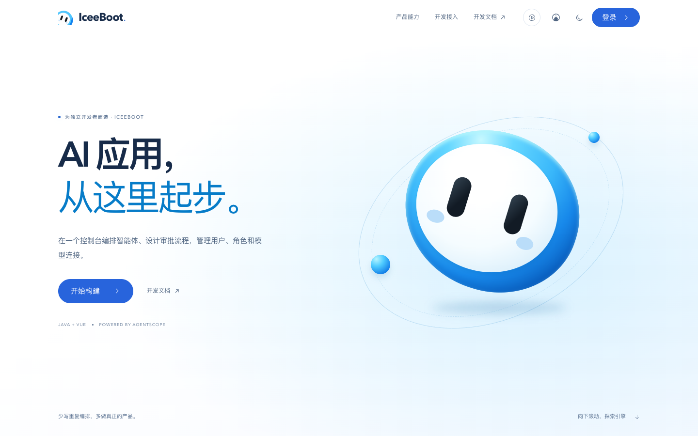

[观看首页上下滚动的动效预览](docs/screenshots/home-scroll.webp)

<a id="mock-start"></a>

## 在本机体验管理台

需要 Node.js 20.19.0 及以上的 20.x 版本，或 Node.js 22.12.0 及以上版本。在前端仓库根目录执行：

```bash
npm ci
npm run dev:mock
```

打开 [本地首页](http://localhost:4396)，点击右上角「登录」。Mock 演示账号是 `admin`，密码是 `111111`。演示使用浏览器端样例数据，适合熟悉页面、调整布局和验证交互。微信授权、真实模型调用、外部支付等联调需要连接后端。

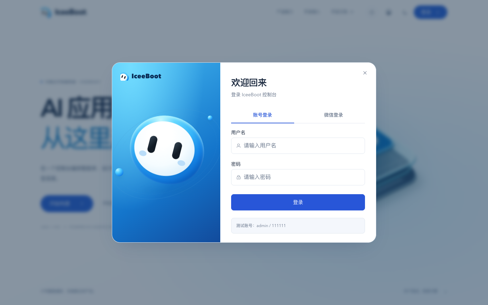

<a id="live-start"></a>

### 连接 Java 后端

1. 在后端工程准备 JDK 21、MySQL 和 Redis，设置后端进程的 `DB_URL`、`DB_USERNAME`、`DB_PASSWORD` 和 Redis 连接信息。首次导入基础 SQL 请使用专用空库。建库、配置示例和启动命令见 [后端数据库配置](https://github.com/perfectNB/IceeBoot-backend-java/blob/master/README.md#database-setup)。
2. 后端启动成功后，可先打开 [本地接口文档](http://localhost:9000/iceeboot/api/swagger-ui/index.html) 确认服务地址。停止占用 4396 端口的 Mock 开发服务。
3. 在前端仓库执行 `npm run dev`，使用该后端已有的账号登录。开发模式默认访问 `http://localhost:9000/iceeboot`。若服务部署在其他地址，在前端根目录建立 `.env.local`，修改后重新启动 Vite。

```dotenv
VITE_APP_BASE_API=http://localhost:9000/iceeboot
VITE_USE_MOCK=false
```

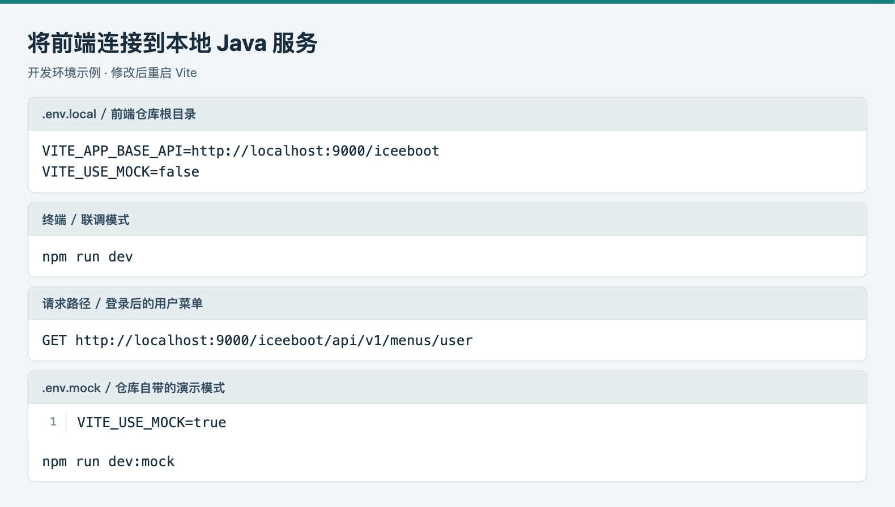

验证登录和菜单时，在浏览器开发者工具的「网络」里查找 `menus/user`。默认本地配置下，完整地址是 `http://localhost:9000/iceeboot/api/v1/menus/user`，响应应包含这个账号可见的菜单。出现 `/api/api/v1` 时，将基础地址末尾改回 `/iceeboot`。浏览器报告跨域错误时，检查后端是否允许当前前端来源。数据库密码、模型和云平台密钥只在后端配置，所有 `VITE_` 变量都可能出现在浏览器中。

## 进入工作台后可以做什么

| 入口 | 使用场景 |
| --- | --- |
| 工作台 | 查看用户数量、登录活动、账号状态和最近操作记录。 |
| 系统管理与监控 | 管理用户、角色、菜单和接口权限，查询运行日志、缓存和任务。不同角色看到的菜单和操作可不同。 |
| 智能体控制台 | 配置模型、提示词和能力，管理 Skill、Tool、MCP、知识库连接与沙箱模板。发布版本后可对话、查看执行记录、用量和产出文件。 |
| 工作流管理 | 在设计器绘制审批路径、配置金额分支、会签角色和发起范围。在「流程定义」维护草稿及版本，在「发起审批」选择模板，在「我的申请」和「我的审批」跟进个人事项。 |
| 三方与支付管理 | 配置文件存储、短信、邮件、支付渠道，查看相关业务记录。真实发送、上传和交易依赖后端渠道配置。 |
| 代码生成 | 选择数据库表并配置生成参数，预览前后端代码。 |


<a id="ai-menu"></a>

## 让 AI 帮你加一个业务菜单

真实模式下，后端根据登录账号返回菜单，前端从 [src/pages](src/pages) 加载对应的 Vue 文件。下例准备新增「系统管理 → 巡检记录」。把前后端两个仓库加入同一工作区，将下方的角色编码占位符替换为你在「角色管理」中为巡检人员创建的角色编码，再把这段需求交给 AI 编程助手。

```text
请先阅读两个仓库的 AGENTS.md，参考系统管理中的现有页面和后端动态权限配置，
为角色 <巡检人员的角色编码> 增加只读「巡检记录」页面。先列出文件、菜单和权限映射，再实现。

1. 父菜单是「系统管理」，路由名 InspectionRecords，路径 /admin/system/inspection-records。
   页面文件为 src/pages/admin/system/InspectionRecords.vue，组件名为 InspectionRecords。
2. 先检查后端是否已有巡检列表接口。如果没有，按同项目的分页接口约定新增。
   页面查看权限为 system:inspection:view，GET /v1/inspections 的接口权限为 system:inspection:list:api。
   前端从 src/api 封装 GET /api/v1/inspections，后端使用 @RequirePermission(dynamic = true)。
3. 按后端现有机制新增可重复执行的版本迁移，登记菜单、权限与目标角色关联。
   通过父菜单、路由名和权限编码查找记录。保留已有授权，只给指定角色授予上述只读能力。
   检查迁移是否已登记，更新接口权限目录与测试。
4. 同步前端 Mock 菜单、角色权限和列表数据，保证 dev:mock 也能演示。
   在本地开发库验证一次有权限账号和一次无权限账号，然后列出检查结果。
```

完成代码修改、应用迁移后，登录开发环境，在下面三个页面核对结果。

1. **系统管理 → 菜单管理。** 找到目标菜单，核对父菜单、菜单标题、路由名、路径和组件。组件名填 `InspectionRecords` 即可匹配 `src/pages/admin/system/InspectionRecords.vue`，大小写要一致，省略 `.vue`。下图以已有的「用户管理」为参照。添加巡检功能时，换成上面给出的路由名、路径与组件。

   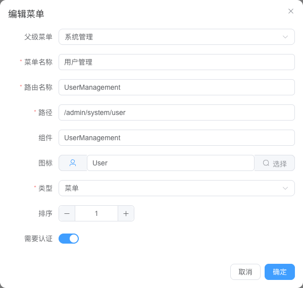

2. **系统管理 → 权限管理。** 找到列表权限，类型选「接口」，核对权限编码、请求方法 `GET`、接口路径 `/v1/inspections`。下图以用户列表 `GET /v1/users` 和权限码 `system:user:list:api` 展示填写位置。巡检接口要换成自己的编码和 Controller 路径。

   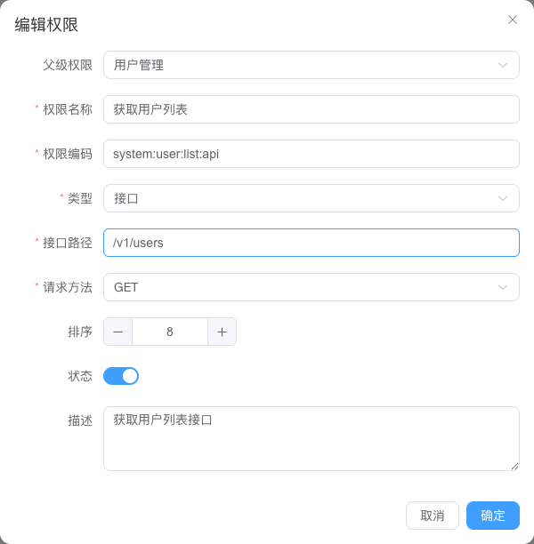

3. **系统管理 → 角色管理。** 在目标角色行点「菜单」，勾选父菜单和页面，点「保存菜单」。

   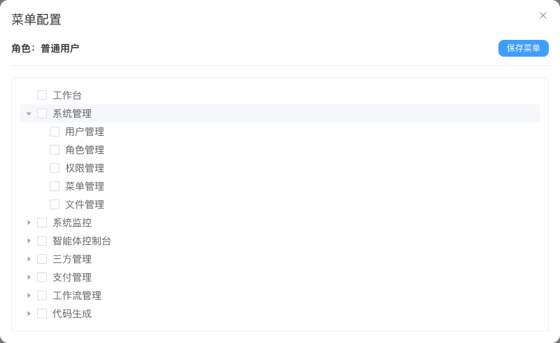

   再点同一角色的「权限」，勾选查看和查询权限，点「保存权限」。重新登录目标角色账号，菜单应能打开并列出数据。另用未授权账号验证直接请求该接口会被拒绝。超级管理员具备全量权限，验收时也要用普通角色。

   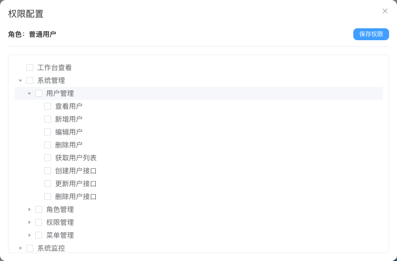

| 遇到的问题 | 从哪里查起 |
| --- | --- |
| 左侧没有菜单 | 看 `GET /api/v1/menus/user` 是否返回该路由，以及当前角色是否有父菜单和页面授权。 |
| 点击菜单后是空白页 | 在控制台查找「未找到菜单组件」，核对组件名、大小写和文件位置。 |
| 能进入页面，查询被拒绝 | 核对当前角色的列表接口权限、HTTP 方法和路径模板。 |

后端迁移与验收步骤见 [后端菜单配置](https://github.com/perfectNB/IceeBoot-backend-java/blob/master/README.md#ai-menu)。

<a id="sandbox-start"></a>

## 配置模型、沙箱模板并发布智能体

下面的控制台截图来自 Mock 演示。以 Python 脚本为例，先熟悉表单，再切到后端联调模式验证真实执行。

1. **连接模型和云平台。** 打开「智能体控制台 → 模型连接」，新建连接，选择供应商及接口协议，填写模型名称与 API Key，启用并保存。列表中的「测试」在真实模式下会发送一次模型请求。

   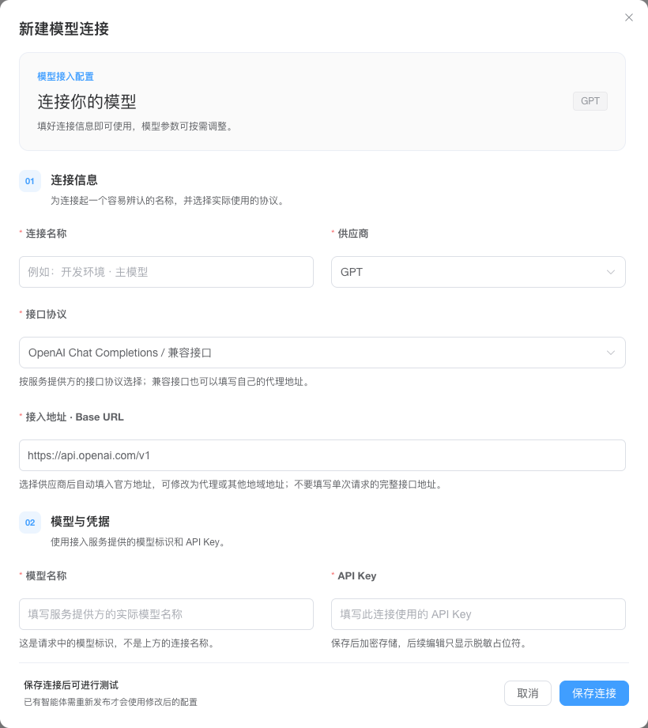

   让后端进程读取 E2B 的 `ALIYUN_E2B_API_BASE_URL`、`ALIYUN_E2B_DOMAIN`、`ALIYUN_E2B_API_KEY`，准备云端已发布、具备 Python 及所需依赖的模板。配置位置与示例见 [后端沙箱配置](https://github.com/perfectNB/IceeBoot-backend-java/blob/master/README.md#e2b-setup)。

2. **登记模板。** 打开「智能体控制台 → 沙箱模板」，先查是否已有可用模板，需要时点「新建沙箱模板」。

   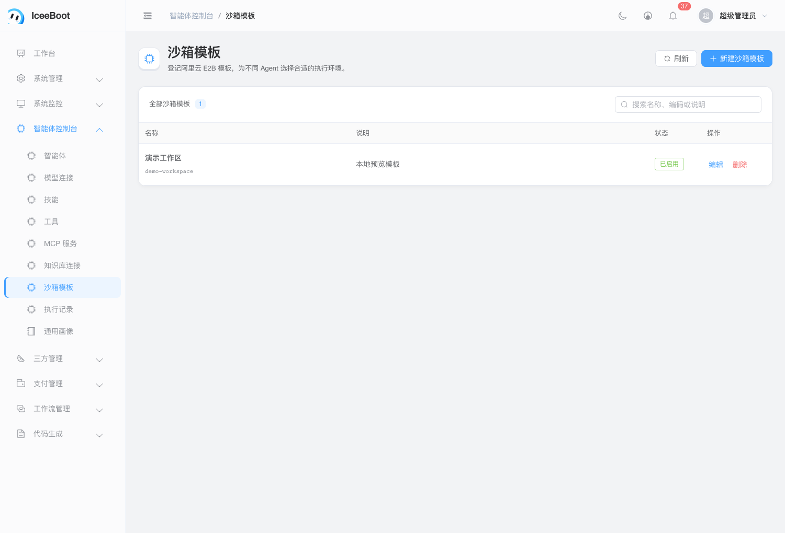

   「名称」可填「Python 报表环境」，「唯一编码」可填 `python_reports`，这是框架里的管理标识，创建后不可修改。「阿里云 E2B 模板 ID / 名称」填你在云端实际发布的模板标识。「沙箱存活时间」单位为秒，默认 600，允许 60–3600。打开「启用沙箱模板」后保存。

   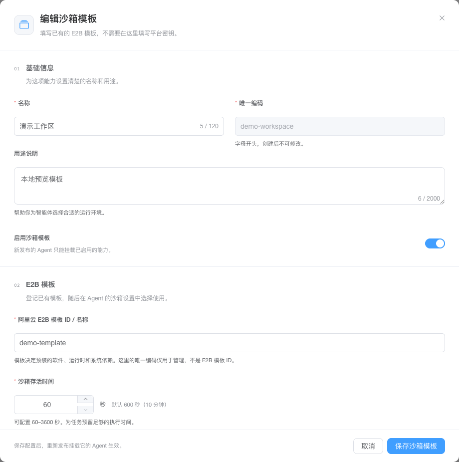

3. **绑定智能体。** 打开「智能体控制台 → 智能体」，新建智能体或编辑已有智能体。在「基础信息」设置名称、唯一编码、运行模型，在「提示词」定义任务。回到「基础信息」的执行设置，打开「E2B 沙箱」并选择刚登记的模板。任务需要凭据时，到「环境变量」配置该智能体使用的变量。

   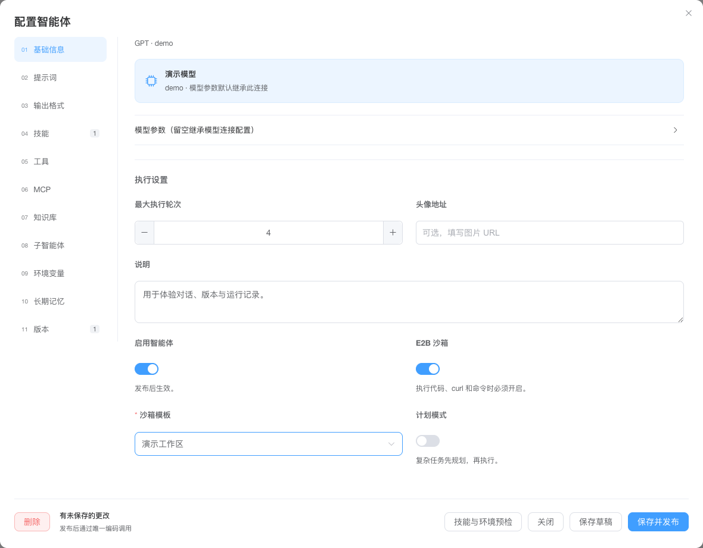

4. **验证执行。** 如需运行已有脚本，在「技能」或「工具」配置并挂载对应能力。先点「保存草稿」，回到列表重新打开「配置 → 技能与环境预检」，点「开始预检」检查已保存的草稿。真实模式下预检会短暂创建并释放环境。

   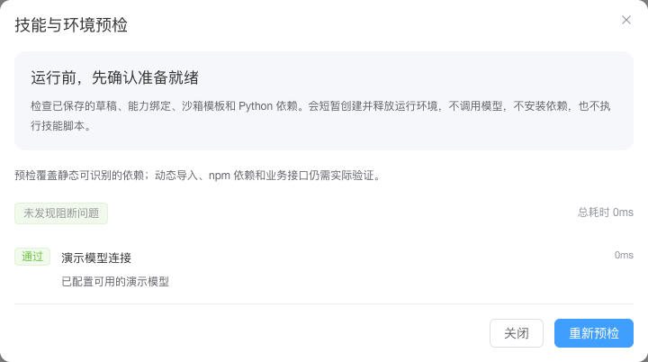

   预检通过后「保存并发布」，回到列表点「开始对话」，发送一个需要该脚本的任务，到「执行记录」核对工具调用与执行结果。模板下拉为空时先检查它是否已启用。运行时找不到依赖，则需要检查云端模板里安装的运行环境。

## 前端架构

页面调用 `src/api` 提供的业务方法。真实模式通过统一请求层发送凭据、处理刷新和接口错误；支持演示的模块在 Mock 模式下切换到本地服务。页面可以沿用同一套表单、查询和分页逻辑。

```text
首页 / 登录 / 管理台页面
        │
        ├── Vue Router + Pinia     路由守卫、登录状态、菜单和操作权限
        └── src/api               按业务组织的方法和类型
              ├── src/utils/request.ts → Java REST API / SSE
              └── src/mock             → 演示服务与样例数据
```

| 路径 | 开发时从哪里入手 |
| --- | --- |
| [src/pages](src/pages) · [src/layouts](src/layouts) | 首页、后台布局和业务页面。审批页面位于 `src/pages/admin/workflow`。 |
| [src/components](src/components) · [src/styles](src/styles) | 共享表单、登录框、品牌动效和主题样式。动画支持系统的「减少动态效果」设置。 |
| [src/router](src/router) · [src/stores](src/stores) | 页面注册、导航守卫、当前用户和菜单状态。操作授权最终由后端校验。 |
| [src/api](src/api) · [src/types](src/types) | 后端路径、请求参数、响应类型与分页契约。 |
| [src/mock](src/mock) · [tests](tests) | 演示数据、与真实接口对应的行为，以及权限、分页、状态变化等回归用例。 |
| [src/locales](src/locales) | 中英文文案。表单提示、按钮和状态文案在这里维护。 |

## 验证与部署

| 命令 | 结果 |
| --- | --- |
| `npm run type-check` | 检查 TypeScript 和 Vue 模板类型。 |
| `sh scripts/verify.sh` | 执行业务与 Mock 测试、ESLint、类型检查和生产构建。 |
| `npm run build` / `npm run build:mock` | 分别生成联调版和演示版静态文件，输出目录为 `dist/`。 |
| `npm run preview` | 在本机预览上一次构建。 |

生产构建前在部署环境设置 `VITE_APP_BASE_API`。静态服务器以 `dist/` 为站点根目录，Vue Router 使用 History 模式，直接刷新 `/admin/…` 时应回退到 `index.html`。如果与 API 共用域名，先匹配 API 的反向代理路径，再处理页面回退。

页面缺少菜单时，先确认账号角色及后端菜单授权。列表正常但按钮不可用时，再检查按钮对应的接口权限。修改接口时同步更新真实请求、Mock 服务和测试，尤其要核对权限过滤后的总数与分页。

配套服务的数据库初始化、环境变量和接口文档见 [IceeBoot 后端 README](https://github.com/perfectNB/IceeBoot-backend-java/blob/master/README.md)。
