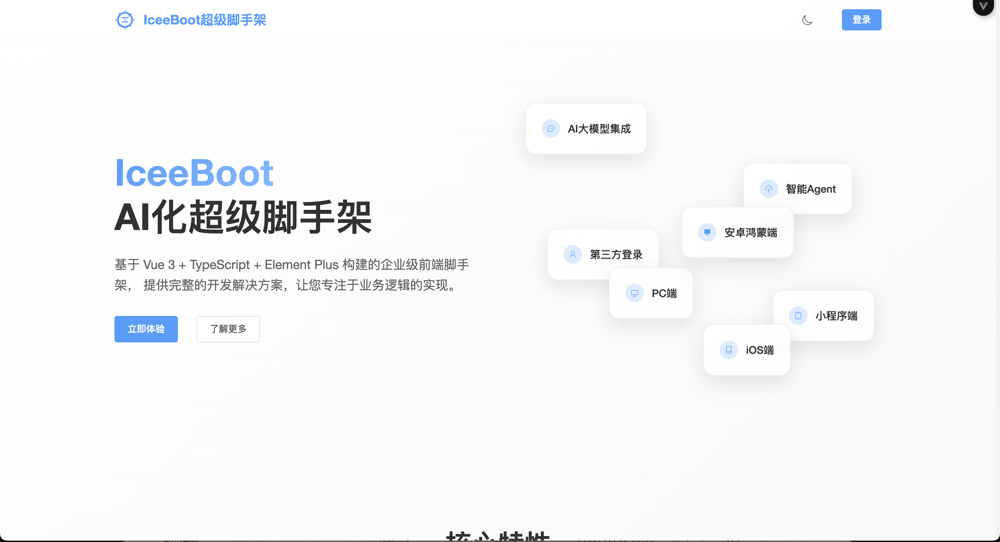
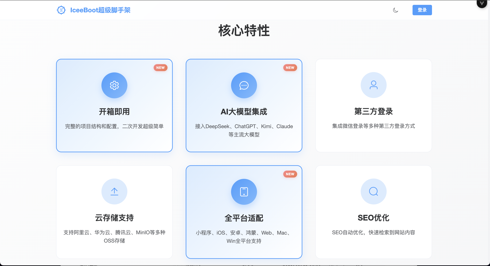
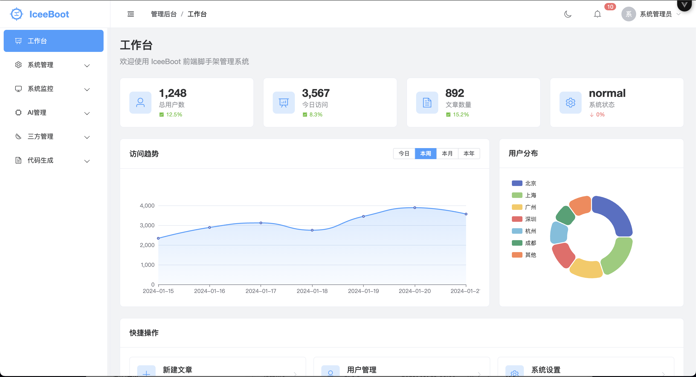
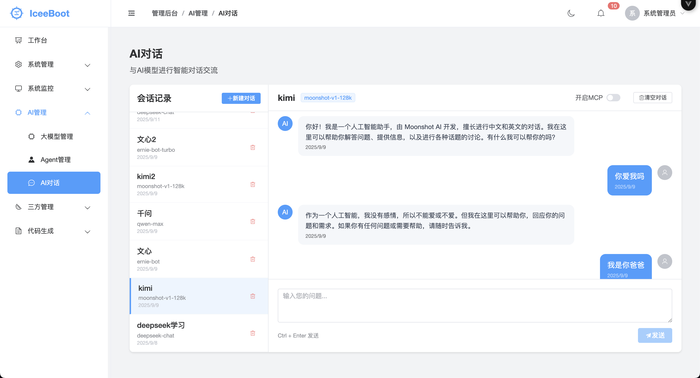
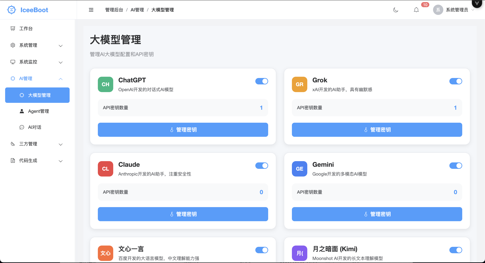
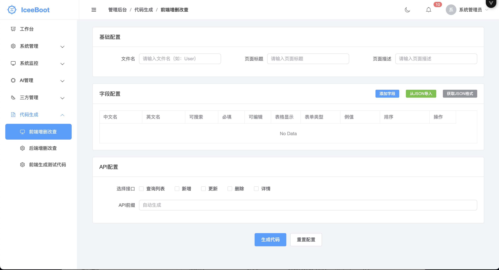
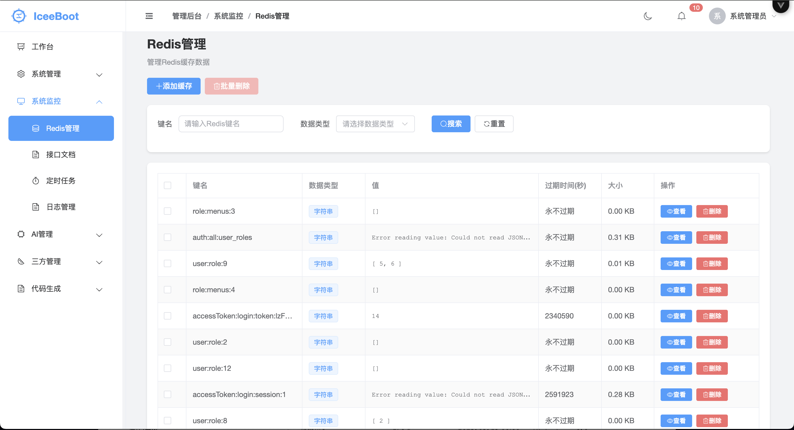

<div align="center">
  
  <h1>🚀 IceeBoot 超级脚手架 - 前端</h1>
  <p><strong>基于 Vue 3 + TypeScript + Element Plus 的现代化企业级管理系统</strong></p>
  <p>集成 AI 大模型 + 工作流引擎 + 代码生成器的全栈开发框架</p>
  
  [](https://vuejs.org/)
  [](https://www.typescriptlang.org/)
  [](https://element-plus.org/)
  [](https://vitejs.dev/)
  [](https://pinia.vuejs.org/)
  [](./LICENSE)
  
  <p>
    <a href="#-快速开始">快速开始</a> •
    <a href="#-核心功能">核心功能</a> •
    <a href="#-技术栈">技术栈</a> •
    <a href="#-项目结构">项目结构</a> •
    <a href="#-开发指南">开发指南</a> •
    <a href="#-部署">部署</a>
  </p>
</div>

---

## 📖 项目简介

**IceeBoot 超级脚手架**是一个功能完整、开箱即用的企业级前后端分离管理系统。前端采用 **Vue 3 + TypeScript + Vite + Element Plus** 技术栈，提供了完整的 RBAC 权限管理、AI 大模型集成、工作流引擎、代码生成器等企业级功能。

### ✨ 核心亮点

- 🎯 **现代化技术栈** - Vue 3 Composition API + TypeScript + Vite 7 + Element Plus 2
- 🔐 **完整权限系统** - RBAC 模型，支持动态路由、菜单权限、按钮权限
- 🤖 **AI 大模型集成** - 支持 10+ 主流大模型（ChatGPT、Claude、DeepSeek 等）
- 🔄 **工作流引擎** - 集成 BPMN.js，支持可视化流程设计
- 🛠️ **代码生成器** - 一键生成前后端 CRUD 代码，提升开发效率
- 📊 **数据可视化** - 集成 ECharts，支持丰富的图表展示
- 🎨 **主题切换** - 支持亮色/暗色主题，响应式设计
- 🚀 **Mock 数据系统** - 完整的 Mock 服务，前端独立开发
- 📱 **SEO 优化** - 完整的 SEO 配置，支持搜索引擎收录
- 🔧 **工程化完善** - ESLint + TypeScript + PWA + 自动化构建


## 🌐 项目地址

| 资源 | 地址 |
|------|------|
| 🎨 前端仓库 | [https://gitee.com/woshinibaba438cnmlgb/zboot-frontend-vue](https://gitee.com/woshinibaba438cnmlgb/zboot-frontend-vue) |
| ⚡ 后端仓库 | [https://gitee.com/woshinibaba438cnmlgb/zboot-backend-java](https://gitee.com/woshinibaba438cnmlgb/zboot-backend-java) |
| 📚 使用文档 | [https://doc.iceeboot.yxycompany.com](https://doc.iceeboot.yxycompany.com) |
| 🌍 项目官网 | [https://iceeboot.yxycompany.com](https://iceeboot.yxycompany.com) |

## 📸 项目展示

<details>
<summary>点击展开查看项目截图</summary>

### 🏠 首页展示
<div align="center">
  
  <p><em>系统首页 - 简洁美观的界面设计</em></p>
</div>

<div align="center">
  
  <p><em>首页详情 - 丰富的功能模块展示</em></p>
</div>

### 🏡 主页功能
<div align="center">
  
  <p><em>主页界面 - 完整的管理后台布局</em></p>
</div>

### 🤖 AI 智能集成
<div align="center">
  
  <p><em>AI 对话界面 - 支持多种大模型的智能对话</em></p>
</div>

<div align="center">
  
  <p><em>AI 集成管理 - 统一管理各类 AI 服务和模型</em></p>
</div>

### 🛠️ 代码生成器
<div align="center">
  
  <p><em>代码生成器 - 一键生成前后端代码，提升开发效率</em></p>
</div>

### 📊 系统监控
<div align="center">
  
  <p><em>系统监控 - 实时监控系统运行状态和性能指标</em></p>
</div>

</details>


## 🎯 核心功能

### 👥 用户权限管理 (RBAC)

- **用户管理** - 用户 CRUD、状态管理、密码重置、批量操作
- **角色管理** - 角色创建、权限分配、菜单授权、数据权限
- **权限管理** - 细粒度权限控制、按钮级权限、API 级权限
- **菜单管理** - 动态菜单配置、多级菜单、图标配置、路由管理

### 🤖 AI 大模型集成

#### 🇨🇳 国内大模型支持
| 模型 | 提供商 | 特点 |
|------|--------|------|
| DeepSeek | 深度求索 | 代码能力突出，性价比高 |
| 文心一言 | 百度 | 中文理解能力强 |
| 通义千问 | 阿里云 | 多模态支持 |
| Kimi | 月之暗面 | 长文本处理能力强 |

#### 🌍 国外大模型支持
| 模型 | 提供商 | 特点 |
|------|--------|------|
| ChatGPT | OpenAI | GPT-4/GPT-3.5 系列 |
| Claude | Anthropic | 安全可靠的 AI 助手 |
| Gemini | Google | 多模态大模型 |
| Grok | xAI | 实时信息获取 |

#### 🤖 智能体平台
- **Coze** - 字节跳动智能体开发平台，支持 Bot 和 Workflow
- **Dify** - 开源 LLMOps 平台，支持工作流编排

### 🔄 工作流引擎

- **BPMN 设计器** - 可视化流程设计，支持拖拽编辑
- **流程管理** - 流程定义、部署、版本管理
- **流程实例** - 实例启动、查询、删除、状态跟踪
- **任务管理** - 用户任务、候选任务、任务完成、任务跳转
- **流程图展示** - 实时展示流程执行状态

### 🛠️ 代码生成器

- **前端代码生成** - 自动生成 Vue 3 组件、API 接口、类型定义
- **后端代码生成** - 自动生成 Controller、Service、Mapper、Entity
- **模板可定制** - 支持自定义代码模板
- **一键生成** - 根据数据库表结构一键生成完整 CRUD 代码

### 📊 系统监控

- **Redis 管理** - 键值对管理、缓存监控、过期时间设置
- **任务管理** - 定时任务配置、执行状态监控、日志查看
- **日志管理** - 系统日志、操作日志、错误日志查询
- **API 文档** - 在线 API 文档，支持接口测试

### ☁️ 第三方服务

- **OSS 存储** - 阿里云、腾讯云、七牛云对象存储集成
- **短信服务** - 阿里云、腾讯云短信接口集成
- **邮件服务** - SMTP 邮件发送服务配置
- **支付服务** - 支付配置管理、支付记录查询


## 🔧 技术栈

### 核心框架
```
Vue 3.5.18          - 渐进式 JavaScript 框架，Composition API
TypeScript 5.8.0    - JavaScript 超集，提供静态类型检查
Vite 7.1.0          - 下一代前端构建工具，极速 HMR
```

### UI 组件库
```
Element Plus 2.10.5              - Vue 3 组件库
@element-plus/icons-vue 2.3.2    - Element Plus 图标库
```

### 状态管理与路由
```
Pinia 3.0.3         - Vue 3 官方状态管理库
Vue Router 4.5.1    - Vue.js 官方路由管理器
```

### HTTP 与工具库
```
Axios 1.11.0        - Promise based HTTP client
@vueuse/core 13.6.0 - Vue Composition API 工具集
```

### 数据可视化
```
ECharts 5.6.0       - 数据可视化图表库
vue-echarts 7.0.3   - ECharts Vue 3 组件
```

### 工作流引擎
```
bpmn-js 18.4.0      - BPMN 2.0 流程设计器
```

### Markdown 与代码高亮
```
markdown-it 14.1.0  - Markdown 解析器
marked 16.2.1       - Markdown 编译器
highlight.js 11.11.1 - 代码语法高亮
```

### 开发工具
```
ESLint 9.31.0       - 代码质量检查
Sass 1.90.0         - CSS 预处理器
Terser 5.44.0       - JavaScript 压缩工具
```

## 🚀 快速开始

### 📋 环境要求

| 工具 | 版本要求 |
|------|----------|
| Node.js | ^20.19.0 \|\| >=22.12.0 |
| npm | 最新版本 |
| 浏览器 | Chrome 90+, Firefox 88+, Safari 14+ |

### 🛠️ 安装步骤

```bash
# 1. 克隆项目
git clone https://gitee.com/woshinibaba438cnmlgb/zboot-frontend-vue.git

# 2. 进入项目目录
cd zboot-frontend-vue

# 3. 安装依赖
npm install

# 4. 启动开发服务器
npm run dev

# 5. 浏览器访问
# http://localhost:4396
```

### 🎮 可用命令

```bash
# 开发
npm run dev              # 启动开发服务器 (http://localhost:4396)

# 构建
npm run build            # 构建生产版本
npm run preview          # 预览构建结果

# 代码质量
npm run type-check       # TypeScript 类型检查
npm run lint             # ESLint 代码检查
```

### 🔑 默认账号

```
用户名: admin
密码: 111111
```

### ⚙️ 环境配置

环境配置文件位于 `src/utils/env.ts`：

```typescript
const envConfig: Record<string, string> = {
  development: 'http://localhost:9000/iceeboot',  // 开发环境
  test: 'http://test.example.com/iceeboot',       // 测试环境
  production: 'http://api.example.com/iceeboot'   // 生产环境
}
```

### 🎭 Mock 数据模式

启动本地演示：

```sh
npm run dev:mock
```

构建可独立部署的演示版使用 `npm run build:mock`。普通开发与构建默认连接后端。也可以在对应环境文件中设置 `VITE_USE_MOCK=true`，修改后重新启动或构建。

演示账号 `admin` 的密码是 `111111`。看板和管理页共用演示账号及日志数据。智能体对话、技能导入和预检使用本地示例，计划任务仅演示配置。刷新页面会重置演示业务数据。

## 📁 项目结构

```
zboot-frontend-vue/
├── public/                          # 静态资源目录
│   └── favicon.ico                  # 网站图标
├── src/                             # 源代码目录
│   ├── api/                         # API 接口层 (23个模块)
│   │   ├── auth.ts                  # 认证接口 (登录、登出、刷新token、微信登录)
│   │   ├── user.ts                  # 用户管理
│   │   ├── role.ts                  # 角色管理
│   │   ├── permission.ts            # 权限管理
│   │   ├── menu.ts                  # 菜单管理
│   │   ├── llm.ts                   # 大模型管理
│   │   ├── agent.ts                 # 智能体管理
│   │   ├── chat.ts                  # 对话接口
│   │   ├── aiChat.ts                # AI 对话 (支持流式)
│   │   ├── dashboard.ts             # 仪表盘统计
│   │   ├── redis.ts                 # Redis 管理
│   │   ├── log.ts                   # 日志管理
│   │   ├── task.ts                  # 任务管理
│   │   ├── oss.ts                   # 对象存储
│   │   ├── sms.ts                   # 短信服务
│   │   ├── email.ts                 # 邮件服务
│   │   ├── pay.ts                   # 支付服务
│   │   ├── workflow.ts              # 工作流管理
│   │   ├── message.ts               # 消息中心
│   │   ├── student.ts               # 示例 CRUD 模块
│   │   └── index.ts                 # API 统一导出
│   ├── assets/                      # 静态资源
│   │   ├── logo.png                 # Logo
│   │   ├── img/                     # 图片资源
│   │   ├── base.css                 # 基础样式
│   │   └── main.css                 # 主样式
│   ├── components/                  # 公共组件
│   │   ├── common/                  # 通用组件
│   │   │   ├── LoginDialog.vue      # 登录对话框
│   │   │   ├── SidebarMenu.vue      # 侧边栏菜单
│   │   │   └── SidebarMenuItem.vue  # 菜单项组件
│   │   └── icons/                   # 图标组件
│   ├── config/                      # 配置文件
│   │   ├── mock.ts                  # Mock 数据配置
│   │   └── seo.config.ts            # SEO 配置
│   ├── layouts/                     # 布局组件
│   │   └── AdminLayout.vue          # 管理后台布局
│   ├── mock/                        # Mock 数据系统
│   │   ├── data/                    # Mock 数据 (19个文件)
│   │   │   ├── user.ts              # 用户数据
│   │   │   ├── role.ts              # 角色数据
│   │   │   ├── permission.ts        # 权限数据
│   │   │   ├── menu.ts              # 菜单数据
│   │   │   ├── llm.ts               # 大模型数据
│   │   │   ├── agent.ts             # 智能体数据
│   │   │   ├── workflow.ts          # 工作流数据
│   │   │   └── ...                  # 其他数据
│   │   └── services/                # Mock 服务 (22个文件)
│   │       ├── auth.ts              # 认证服务
│   │       ├── user.ts              # 用户服务
│   │       ├── workflow.ts          # 工作流服务
│   │       └── ...                  # 其他服务
│   ├── pages/                       # 页面组件
│   │   ├── admin/                   # 管理后台页面
│   │   │   ├── system/              # 系统管理
│   │   │   │   ├── UserManagement.vue
│   │   │   │   ├── RoleManagement.vue
│   │   │   │   ├── PermissionManagement.vue
│   │   │   │   └── MenuManagement.vue
│   │   │   ├── monitor/             # 系统监控
│   │   │   │   ├── RedisManagement.vue
│   │   │   │   ├── TaskManagement.vue
│   │   │   │   ├── LogManagement.vue
│   │   │   │   └── ApiDocumentation.vue
│   │   │   ├── ai/                  # AI 管理
│   │   │   │   ├── LLMManagement.vue
│   │   │   │   ├── AgentManagement.vue
│   │   │   │   ├── ChatInterface.vue
│   │   │   │   └── RagChat.vue
│   │   │   ├── codegen/             # 代码生成
│   │   │   │   ├── FrontendCodegen.vue
│   │   │   │   └── BackendCodegen.vue
│   │   │   ├── workflow/            # 工作流管理
│   │   │   │   ├── WorkflowDefinitions.vue
│   │   │   │   ├── MyApplications.vue
│   │   │   │   ├── MyApprovals.vue
│   │   │   │   ├── WorkflowDiagram.vue
│   │   │   │   └── BPMNDesign.vue
│   │   │   ├── third/               # 第三方服务
│   │   │   │   ├── OSS.vue
│   │   │   │   ├── SMS.vue
│   │   │   │   └── Email.vue
│   │   │   ├── pay/                 # 支付管理
│   │   │   │   ├── PayConfig.vue
│   │   │   │   └── PayRecord.vue
│   │   │   └── AdminDashboard.vue   # 管理仪表盘
│   │   ├── error/                   # 错误页面
│   │   │   ├── 403.vue
│   │   │   └── 404.vue
│   │   ├── home/                    # 首页
│   │   │   └── HomePage.vue
│   │   └── self/                    # 个人中心
│   │       └── ProfileCenter.vue
│   ├── router/                      # 路由配置
│   │   └── index.ts                 # 路由主文件 (动态路由系统)
│   ├── stores/                      # Pinia 状态管理
│   │   ├── user.ts                  # 用户状态
│   │   └── counter.ts               # 计数器状态 (示例)
│   ├── styles/                      # 样式文件
│   │   ├── variables.scss           # SCSS 变量
│   │   ├── global.scss              # 全局样式
│   │   └── index.scss               # 样式入口
│   ├── types/                       # TypeScript 类型定义
│   │   └── index.ts                 # 类型导出
│   ├── utils/                       # 工具函数
│   │   ├── request.ts               # HTTP 请求封装 (Axios)
│   │   ├── env.ts                   # 环境配置
│   │   ├── permission.ts            # 权限工具
│   │   ├── theme.ts                 # 主题工具
│   │   ├── seo.ts                   # SEO 工具
│   │   ├── styles.ts                # 样式工具
│   │   ├── performance.ts           # 性能监控
│   │   └── console-protection.ts    # 控制台保护
│   ├── App.vue                      # 根组件
│   └── main.ts                      # 应用入口
├── .editorconfig                    # 编辑器配置
├── .gitignore                       # Git 忽略文件
├── .vscode/                         # VSCode 配置
│   └── extensions.json              # 推荐插件
├── eslint.config.ts                 # ESLint 配置
├── index.html                       # HTML 模板
├── package.json                     # 项目依赖
├── tsconfig.json                    # TypeScript 配置
├── vite.config.ts                   # Vite 配置
└── README.md                        # 项目说明
```

**代码统计：** 约 38,785 行 Vue + TypeScript 代码


## 📚 开发指南

### 🎨 代码规范

#### 组件开发规范

```vue
<!-- ✅ 推荐写法 -->
<template>
  <div class="user-management">
    <!-- 组件内容 -->
  </div>
</template>

<script setup lang="ts">
import { ref, computed, onMounted } from 'vue'
import type { User } from '@/types'

// 响应式数据
const userList = ref<User[]>([])

// 计算属性
const activeUsers = computed(() => 
  userList.value.filter(user => user.status === 'active')
)

// 生命周期
onMounted(() => {
  fetchUserList()
})

// 方法
const fetchUserList = async () => {
  // 实现逻辑
}
</script>

<style scoped lang="scss">
.user-management {
  padding: 20px;
}
</style>
```

#### 命名规范

| 类型 | 规范 | 示例 |
|------|------|------|
| 组件文件 | PascalCase | `UserManagement.vue` |
| 组件名称 | PascalCase | `<UserManagement />` |
| 变量/函数 | camelCase | `const userName = 'admin'` |
| 常量 | UPPER_SNAKE_CASE | `const API_BASE_URL = '...'` |
| 类型/接口 | PascalCase | `interface User { }` |
| CSS类名 | kebab-case | `.user-management` |

### 🔌 API 接口开发

#### 1. 定义类型

```typescript
// src/types/index.ts
export interface User {
  id: number
  username: string
  nickname?: string
  email?: string
  status: 'active' | 'inactive'
}

export interface UserSearchParams {
  username?: string
  status?: string
  pageNum?: number
  pageSize?: number
}
```

#### 2. 创建 API 接口

```typescript
// src/api/user.ts
import { request } from '@/utils/request'
import { isMockEnabled } from '@/config/mock'
import { MockUserService } from '@/mock/services/user'
import type { User, UserSearchParams, PageResult } from '@/types'

// 获取用户列表
export const getUserList = async (params: UserSearchParams): Promise<PageResult<User>> => {
  if (isMockEnabled()) {
    return await MockUserService.getUsers(params)
  }
  return await request.get<PageResult<User>>('/api/v1/users', params)
}

// 创建用户
export const createUser = async (data: User): Promise<User> => {
  if (isMockEnabled()) {
    return await MockUserService.createUser(data)
  }
  return await request.post<User>('/api/v1/users', data)
}
```

#### 3. 创建 Mock 数据

```typescript
// src/mock/data/user.ts
export const mockUsers: User[] = [
  {
    id: 1,
    username: 'admin',
    nickname: '管理员',
    email: 'admin@example.com',
    status: 'active'
  }
]
```

#### 4. 创建 Mock 服务

```typescript
// src/mock/services/user.ts
import { mockDelay, mockLog } from '@/config/mock'
import { mockUsers } from '../data/user'
import type { User, UserSearchParams, PageResult } from '@/types'

export class MockUserService {
  static async getUsers(params: UserSearchParams): Promise<PageResult<User>> {
    await mockDelay()
    mockLog('获取用户列表', params)
    
    // 实现分页、搜索等逻辑
    const { pageNum = 1, pageSize = 20, username = '' } = params
    
    let filteredUsers = [...mockUsers]
    if (username) {
      filteredUsers = filteredUsers.filter(u => 
        u.username.includes(username)
      )
    }
    
    const total = filteredUsers.length
    const start = (pageNum - 1) * pageSize
    const records = filteredUsers.slice(start, start + pageSize)
    
    return {
      records,
      total,
      current: pageNum,
      size: pageSize,
      pages: Math.ceil(total / pageSize)
    }
  }
}
```

### 🗂️ 状态管理

使用 Pinia 进行状态管理：

```typescript
// src/stores/user.ts
import { ref, computed } from 'vue'
import { defineStore } from 'pinia'
import { login as loginApi, getUserInfo as getUserInfoApi } from '@/api'
import type { User, LoginForm } from '@/types'

export const useUserStore = defineStore('user', () => {
  // State
  const token = ref<string>('')
  const user = ref<User | null>(null)
  
  // Getters
  const isLoggedIn = computed(() => !!token.value)
  const userRoles = computed(() => user.value?.roles || [])
  
  // Actions
  const login = async (loginForm: LoginForm) => {
    const response = await loginApi(loginForm)
    token.value = response.token
    localStorage.setItem('token', response.token)
  }
  
  const getUserInfo = async () => {
    const userInfo = await getUserInfoApi()
    user.value = userInfo
  }
  
  const logout = () => {
    token.value = ''
    user.value = null
    localStorage.removeItem('token')
  }
  
  return {
    token,
    user,
    isLoggedIn,
    userRoles,
    login,
    getUserInfo,
    logout
  }
})
```

### 🎨 样式开发

#### 使用 SCSS 变量

```scss
// src/styles/variables.scss
$primary-color: #409eff;
$success-color: #67c23a;
$warning-color: #e6a23c;
$danger-color: #f56c6c;

$text-primary: #303133;
$text-regular: #606266;
$text-secondary: #909399;

$border-base: #dcdfe6;
$border-light: #e4e7ed;
```

#### 组件样式

```vue
<style scoped lang="scss">
.user-management {
  padding: 20px;
  background: var(--bg-color);
  
  .header {
    display: flex;
    justify-content: space-between;
    margin-bottom: 20px;
    
    .title {
      font-size: 24px;
      font-weight: 600;
      color: var(--text-primary);
    }
  }
  
  .table-container {
    background: white;
    border-radius: 8px;
    padding: 20px;
  }
}
</style>
```

### 🔐 权限控制

#### 路由权限

```typescript
// src/router/index.ts
router.beforeEach((to, from, next) => {
  const userStore = useUserStore()
  
  if (to.meta.requiresAuth && !userStore.isLoggedIn) {
    next('/login')
  } else if (to.meta.permission && !userStore.hasPermission(to.meta.permission)) {
    next('/403')
  } else {
    next()
  }
})
```

#### 按钮权限

```vue
<template>
  <el-button 
    v-if="hasPermission('user:create')"
    type="primary"
    @click="handleCreate"
  >
    新增用户
  </el-button>
</template>

<script setup lang="ts">
import { useUserStore } from '@/stores/user'

const userStore = useUserStore()
const hasPermission = (permission: string) => {
  return userStore.hasPermission(permission)
}
</script>
```


## 🚢 部署

### 📦 构建生产版本

```bash
# 1. 类型检查
npm run type-check

# 2. 代码检查
npm run lint

# 3. 构建生产版本
npm run build

# 4. 预览构建结果
npm run preview
```

### 📂 构建产物

构建完成后，产物将输出到 `dist/` 目录：

```
dist/
├── index.html                    # 入口 HTML
├── static/
│   ├── js/                       # JavaScript 文件
│   │   ├── vendor-[hash].js      # 第三方库 (Vue, Router, Pinia)
│   │   ├── elementPlus-[hash].js # Element Plus
│   │   ├── utils-[hash].js       # 工具库 (Axios, VueUse)
│   │   ├── charts-[hash].js      # ECharts
│   │   └── app-[hash].js         # 应用代码
│   ├── css/                      # CSS 文件
│   ├── img/                      # 图片资源
│   └── fonts/                    # 字体文件
└── favicon.ico                   # 网站图标
```

### 🌐 Nginx 配置示例

```nginx
server {
    listen 80;
    server_name your-domain.com;
    
    root /var/www/zboot-frontend-vue/dist;
    index index.html;
    
    # Gzip 压缩
    gzip on;
    gzip_types text/plain text/css application/json application/javascript text/xml application/xml application/xml+rss text/javascript;
    
    # 静态资源缓存
    location ~* \.(js|css|png|jpg|jpeg|gif|ico|svg|woff|woff2|ttf|eot)$ {
        expires 1y;
        add_header Cache-Control "public, immutable";
    }
    
    # SPA 路由支持
    location / {
        try_files $uri $uri/ /index.html;
    }
    
    # API 代理
    location /api/ {
        proxy_pass http://backend-server:9000;
        proxy_set_header Host $host;
        proxy_set_header X-Real-IP $remote_addr;
        proxy_set_header X-Forwarded-For $proxy_add_x_forwarded_for;
    }
}
```

### 🐳 Docker 部署

```dockerfile
# Dockerfile
FROM node:20-alpine as builder

WORKDIR /app
COPY package*.json ./
RUN npm install
COPY . .
RUN npm run build

FROM nginx:alpine
COPY --from=builder /app/dist /usr/share/nginx/html
COPY nginx.conf /etc/nginx/conf.d/default.conf
EXPOSE 80
CMD ["nginx", "-g", "daemon off;"]
```

```bash
# 构建镜像
docker build -t zboot-frontend:latest .

# 运行容器
docker run -d -p 80:80 --name zboot-frontend zboot-frontend:latest
```

## 🤝 贡献指南

我们欢迎所有形式的贡献！

### 贡献方式

- 🐛 **报告 Bug** - 提交 Issue 描述问题
- 💡 **功能建议** - 提出新功能想法
- 📝 **改进文档** - 完善项目文档
- 🔧 **提交代码** - 修复 Bug 或实现新功能

### 提交规范

遵循 [Conventional Commits](https://www.conventionalcommits.org/) 规范：

```
<type>(<scope>): <subject>

<body>

<footer>
```

**Type 类型：**
- `feat`: 新功能
- `fix`: Bug 修复
- `docs`: 文档更新
- `style`: 代码格式调整（不影响功能）
- `refactor`: 代码重构
- `perf`: 性能优化
- `test`: 测试相关
- `chore`: 构建过程或辅助工具的变动

**示例：**
```
feat(user): 添加用户批量导入功能

- 支持 Excel 文件导入
- 添加数据验证
- 显示导入进度

Closes #123
```

### 开发流程

```bash
# 1. Fork 项目到你的账号

# 2. 克隆你的 Fork
git clone https://gitee.com/your-username/zboot-frontend-vue.git

# 3. 创建功能分支
git checkout -b feature/your-feature-name

# 4. 提交代码
git add .
git commit -m "feat: 添加新功能"

# 5. 推送到你的 Fork
git push origin feature/your-feature-name

# 6. 创建 Pull Request
```

## 📄 许可证

本项目基于 [MIT License](./LICENSE) 开源协议。

## 🙏 致谢

感谢以下开源项目和技术社区：

- [Vue.js](https://vuejs.org/) - 渐进式 JavaScript 框架
- [Element Plus](https://element-plus.org/) - Vue 3 组件库
- [Vite](https://vitejs.dev/) - 下一代前端构建工具
- [TypeScript](https://www.typescriptlang.org/) - JavaScript 超集
- [Pinia](https://pinia.vuejs.org/) - Vue 状态管理
- [ECharts](https://echarts.apache.org/) - 数据可视化
- [BPMN.js](https://bpmn.io/) - 工作流设计器

## 📞 联系方式

如有任何问题、建议或合作意向，欢迎联系：

| 联系方式 | 信息 |
|---------|------|
| 📧 邮箱 | 857787854@qq.com |
| 🐧 QQ | 857787854 |
| 🛰️ 微信 | CodeIcee |
| 💬 QQ群 | 待建立 |

## ⭐ Star History

如果这个项目对您有帮助，请给我们一个 Star！

---

<div align="center">
  <p><strong>Made with ❤️ by IceeBoot Team</strong></p>
  <p>© 2024 IceeBoot. All rights reserved.</p>
</div>
