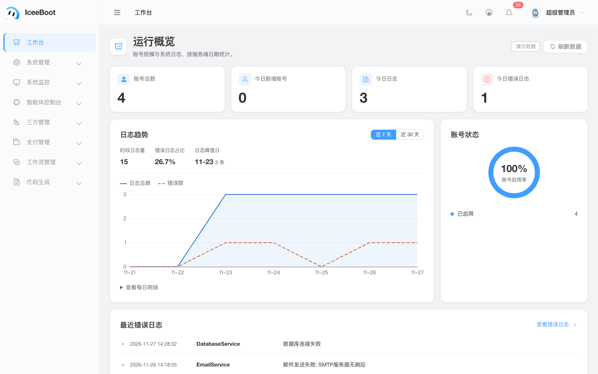

# IceeBoot 前端

IceeBoot 是一个用 Vue 3 和 TypeScript 编写的 AI 应用管理台。访客从首页了解产品并登录，业务用户在工作台发起和办理审批，管理员配置角色、智能体、模型连接和基础服务。界面支持中文、英文与明暗主题。


[观看首页上下滚动的动效预览](docs/screenshots/home-scroll.webp)

## 先跑起来

需要 Node.js 20.19 以上的 20.x 版本，或 Node.js 22.12 及以上版本。在前端仓库根目录执行：

```bash
npm ci
npm run dev:mock
```

打开 [本地首页](http://localhost:4396)，点击右上角「登录」。Mock 演示账号是 `admin`，密码是 `111111`。演示使用浏览器端样例数据，适合熟悉页面、调整布局和验证交互。微信授权、真实模型调用、外部支付等联调需要连接后端。


### 连接 Java 后端

启动配套后端后，在本仓库执行 `npm run dev`，使用该后端已有的账号登录。开发模式默认访问 `http://localhost:9000/iceeboot`。若服务部署在其他地址，在前端根目录建立 `.env.local`，修改后重新启动 Vite。

```dotenv
VITE_APP_BASE_API=http://localhost:9000/iceeboot
VITE_USE_MOCK=false
```

业务请求会追加 `/api/v1/…`。例如填写上述基础地址后，审批列表会访问 `/iceeboot/api/v1/workflow/approvals/cases`。前后端使用不同域名时，后端也需要允许前端的来源。前端环境变量会进入浏览器构建产物，服务商密钥由后端配置。

## 进入工作台后可以做什么

| 入口 | 使用场景 |
| --- | --- |
| 工作台 | 查看用户数量、登录活动、账号状态和最近操作记录。 |
| 系统管理与监控 | 管理用户、角色、菜单和接口权限，查询运行日志、缓存和任务。不同角色看到的菜单和操作可不同。 |
| 智能体控制台 | 配置模型、提示词和能力，管理 Skill、Tool、MCP、知识库连接与沙箱模板。发布版本后可对话、查看执行记录、用量和产出文件。 |
| 工作流管理 | 在设计器绘制审批路径、配置金额分支、会签角色和发起范围。在「流程定义」维护草稿及版本，在「发起审批」选择模板，在「我的申请」和「我的审批」跟进个人事项。 |
| 三方与支付管理 | 配置文件存储、短信、邮件、支付渠道，查看相关业务记录。真实发送、上传和交易依赖后端渠道配置。 |
| 代码生成 | 选择数据库表并配置生成参数，预览前后端代码。 |



## 前端架构

页面调用 `src/api` 提供的业务方法。真实模式通过统一请求层发送凭据、处理刷新和接口错误；支持演示的模块在 Mock 模式下切换到本地服务。页面可以沿用同一套表单、查询和分页逻辑。

```text
首页 / 登录 / 管理台页面
        │
        ├── Vue Router + Pinia     路由守卫、登录状态、菜单和操作权限
        └── src/api               按业务组织的方法和类型
              ├── src/utils/request.ts → Java REST API / SSE
              └── src/mock             → 演示服务与样例数据
```

| 路径 | 开发时从哪里入手 |
| --- | --- |
| [src/pages](src/pages) · [src/layouts](src/layouts) | 首页、后台布局和业务页面。审批页面位于 `src/pages/admin/workflow`。 |
| [src/components](src/components) · [src/styles](src/styles) | 共享表单、登录框、品牌动效和主题样式。动画支持系统的「减少动态效果」设置。 |
| [src/router](src/router) · [src/stores](src/stores) | 页面注册、导航守卫、当前用户和菜单状态。操作授权最终由后端校验。 |
| [src/api](src/api) · [src/types](src/types) | 后端路径、请求参数、响应类型与分页契约。 |
| [src/mock](src/mock) · [tests](tests) | 演示数据、与真实接口对应的行为，以及权限、分页、状态变化等回归用例。 |
| [src/locales](src/locales) | 中英文文案。表单提示、按钮和状态文案在这里维护。 |

## 验证与部署

| 命令 | 结果 |
| --- | --- |
| `npm run type-check` | 检查 TypeScript 和 Vue 模板类型。 |
| `sh scripts/verify.sh` | 执行业务与 Mock 测试、ESLint、类型检查和生产构建。 |
| `npm run build` / `npm run build:mock` | 分别生成联调版和演示版静态文件，输出目录为 `dist/`。 |
| `npm run preview` | 在本机预览上一次构建。 |

生产构建前在部署环境设置 `VITE_APP_BASE_API`。静态服务器以 `dist/` 为站点根目录，Vue Router 使用 History 模式，直接刷新 `/admin/…` 时应回退到 `index.html`。如果与 API 共用域名，先匹配 API 的反向代理路径，再处理页面回退。

页面缺少菜单时，先确认账号角色及后端菜单授权。列表正常但按钮不可用时，再检查按钮对应的接口权限。修改接口时同步更新真实请求、Mock 服务和测试，尤其要核对权限过滤后的总数与分页。

配套服务的数据库初始化、环境变量和接口文档见 [IceeBoot 后端 README](https://gitee.com/woshinibaba438cnmlgb/zboot-backend-java/blob/20261110-agentscope-harness/README.md)。
